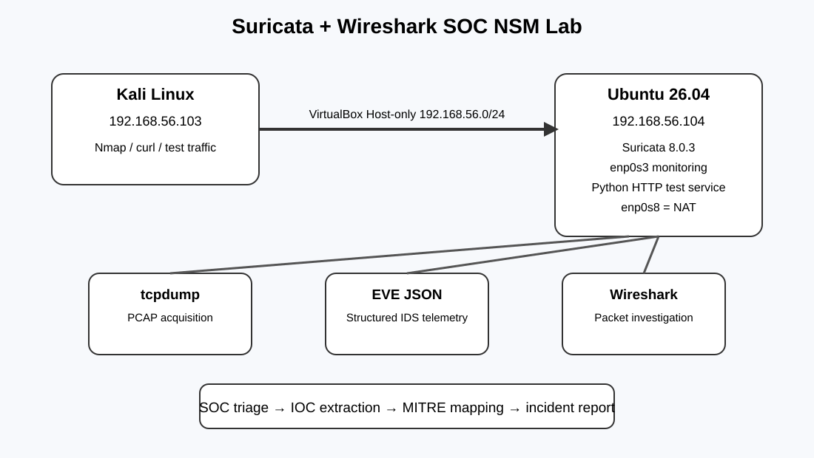

# Suricata + Wireshark Network Security Monitoring Lab


## Project Overview

This project is an isolated, reproducible SOC-style Network Security Monitoring (NSM) lab built with VirtualBox. A Kali Linux VM generates controlled traffic toward an Ubuntu VM. Ubuntu hosts Suricata and the packet-analysis workflow used to capture, detect, investigate, and document network activity.

The project demonstrates a practical SOC workflow rather than only an IDS installation:

**Generate traffic → Capture packets → Detect → Triage → Correlate with PCAP → Extract IOCs → Map activity → Document the incident**

### What was implemented

- Suricata 8.0.3 IDS on Ubuntu 26.04 LTS
- Wireshark for packet-level investigation
- tcpdump for PCAP acquisition
- Python scripts for alert parsing and IOC extraction
- jq for EVE JSON validation/analysis
- Custom Suricata signature for controlled HTTP service access
- Controlled TCP reconnaissance using Nmap
- Controlled HTTP traffic using Python's built-in HTTP server and curl
- Incident documentation and MITRE ATT&CK mapping
- GitHub-ready project structure and reproducibility notes

> **Safety note:** All traffic in this project was generated between the author's own isolated VirtualBox VMs on the `192.168.56.0/24` host-only network. No public or third-party systems were scanned.

## Architecture

```text
                    Windows Host
                         |
                    Oracle VirtualBox
                         |
          +--------------+--------------+
          |                             |
   Kali Linux 2025.4              Ubuntu 26.04 LTS
   192.168.56.103                  192.168.56.104
        eth0                            enp0s3
          |                                |
          +------ Host-only ---------------+
                         |
                  Suricata 8.0.3
                         |
              +----------+----------+
              |                     |
          EVE JSON              PCAP files
              |                     |
          Python/jq              Wireshark
              |                     |
              +----------+----------+
                         |
                  SOC investigation
                         |
          Alerts / IOCs / Incidents / Reports

Ubuntu enp0s8 (10.0.3.15/24) = NAT/Internet for package updates.
Suricata monitoring interface = enp0s3 only.
```



## Lab Environment

| Component | Details |
|---|---|
| Host | Windows + Oracle VirtualBox |
| Attacker/test VM | Kali Linux 2025.4 |
| Kali host-only IP | `192.168.56.103` |
| Kali host-only interface | `eth0` |
| Monitoring VM | Ubuntu 26.04 LTS |
| Ubuntu host-only IP | `192.168.56.104` |
| Ubuntu host-only interface | `enp0s3` |
| Ubuntu NAT interface | `enp0s8` / `10.0.3.15` |
| IDS | Suricata 8.0.3 |
| Packet analysis | Wireshark |
| Capture | tcpdump |
| JSON analysis | jq |
| Automation/analysis | Python 3 |

## Repository Structure

```text
suricata-wireshark-nsm/
├── README.md
├── LICENSE
├── CONTRIBUTING.md
├── SECURITY.md
├── .gitignore
├── architecture/
│   └── architecture.svg
├── detections/
│   ├── network-recon.md
│   └── http-analysis.md
├── incidents/
│   ├── INC-001-network-recon.md
│   └── INC-002-http-service.md
├── reports/
│   └── project-summary.md
├── scripts/
│   ├── alerts.py
│   └── ioc_extract.py
├── suricata/
│   ├── local.rules
│   └── configuration.md
├── docs/
│   └── reproducibility.md
└── screenshots/
    ├── 01-ubuntu-network.png
    ├── 02-kali-network.png
    ├── 03-suricata-config-test.png
    ├── 04-custom-suricata-rule.png
    ├── 05-suricata-alerts.png
    ├── 06-ioc-extraction.png
    ├── 07-network-recon-wireshark.png
    ├── 08-http-get-wireshark.png
    └── 09-http-response-wireshark.png
```

## 1. Network Validation

Ubuntu host-only interface:

```bash
ip addr show enp0s3
```

Expected lab address:

```text
192.168.56.104/24
```

Kali host-only interface:

```bash
ip addr show eth0
```

Expected lab address:

```text
192.168.56.103/24
```

Connectivity test from Kali:

```bash
ping -c 10 192.168.56.104
```

The host-only network is the monitored lab segment. Ubuntu's NAT interface is used for Internet/package access and is not the Suricata monitoring interface.

## 2. Suricata Configuration

The active capture interface is `enp0s3`.

The configuration was validated with:

```bash
sudo suricata -T -c /etc/suricata/suricata.yaml
```

Successful validation produced:

```text
Configuration provided was successfully loaded. Exiting.
```

The project uses the Suricata rule directory configured by the system:

```text
/var/lib/suricata/rules
```

The custom rule is stored as:

```text
/var/lib/suricata/rules/local.rules
```

See [`suricata/configuration.md`](suricata/configuration.md) for the relevant configuration details.

## 3. Detection Engineering

A custom signature was created for controlled access to the lab HTTP service on TCP/8080:

```suricata
alert tcp $HOME_NET any -> $HOME_NET 8080 (msg:"SOC LAB - HTTP Test Service Access"; flow:to_server; sid:1000001; rev:1;)
```

The rule was loaded successfully and triggered when Kali accessed the Ubuntu test service.

This demonstrates the detection-engineering cycle:

1. Define a known lab behavior.
2. Create a signature for that behavior.
3. Validate the Suricata configuration.
4. Generate the controlled traffic.
5. Confirm the alert in EVE telemetry.
6. Correlate the alert with packet-level evidence.

## 4. Network Reconnaissance Investigation

Controlled reconnaissance was generated from Kali against the Ubuntu VM:

```bash
nmap -sS 192.168.56.104
nmap -sV 192.168.56.104
```

The observed scan traffic contains repeated TCP SYN probes from `192.168.56.103` to multiple destination ports on `192.168.56.104`. The Nmap result reported the host as up with the scanned TCP ports closed in the tested state.

The packet capture was reviewed in Wireshark and provides packet-level evidence of the reconnaissance behavior.

This activity is documented as a controlled lab investigation and mapped to **MITRE ATT&CK T1046 – Network Service Scanning**.

See [`incidents/INC-001-network-recon.md`](incidents/INC-001-network-recon.md).

## 5. HTTP Detection Investigation

Ubuntu hosted a controlled HTTP service:

```bash
python3 -m http.server 8080 --bind 192.168.56.104
```

Kali generated the request:

```bash
curl http://192.168.56.104:8080/
```

The packet capture showed:

- TCP three-way handshake
- HTTP `GET / HTTP/1.1`
- `Host: 192.168.56.104:8080`
- `User-Agent: curl/8.21.0`
- HTTP `200 OK` response
- TCP connection close

Suricata generated the custom alert:

```text
SOC LAB - HTTP Test Service Access
```

The existing Suricata ruleset also generated an informational Python SimpleHTTP server banner event.

See [`incidents/INC-002-http-service.md`](incidents/INC-002-http-service.md) and [`detections/http-analysis.md`](detections/http-analysis.md).

## 6. EVE JSON Analysis

Suricata EVE JSON was parsed using Python and jq. During the lab, the active EVE file contained NUL bytes in one corrupted line, causing strict JSON parsing to fail. The original file was preserved, and a clean analysis copy was created by removing NUL bytes:

```bash
sudo tr -d '\000' < /var/log/suricata/eve.json > ~/soc-nsm-lab/eve-clean.json
jq -c . ~/soc-nsm-lab/eve-clean.json > /dev/null
```

The cleaned copy successfully passed JSON validation and was used for analysis. The raw EVE log and cleaned telemetry are intentionally excluded from GitHub through `.gitignore`.

## 7. IOC Extraction

The project includes a Python IOC extraction script that summarizes source IPs, destination IPs, and destination ports from Suricata alert events.

Run it against the live log when the EVE file is valid:

```bash
sudo python3 scripts/ioc_extract.py
```

For the cleaned historical lab dataset, update `LOG_FILE` to:

```text
/home/vboxuser/soc-nsm-lab/eve-clean.json
```

The observed lab telemetry included `192.168.56.103` as a primary source and `192.168.56.104` as a primary destination, with TCP/8080 associated with the controlled HTTP detection.

## 8. Evidence Correlation

The project intentionally correlates multiple evidence sources instead of relying on a single alert:

| Evidence | Purpose |
|---|---|
| Nmap output | Establishes the generated reconnaissance action |
| tcpdump PCAP | Preserves raw network packets |
| Wireshark | Provides packet-level investigation |
| Suricata EVE JSON | Provides structured IDS telemetry |
| Custom rule | Demonstrates detection engineering |
| Python parser | Automates alert triage |
| IOC extraction | Summarizes investigation indicators |
| Incident reports | Documents analyst reasoning and response |

## 9. DNS Limitation

A DNS capture was attempted on Ubuntu `enp0s3`, but no packets were captured because Kali's DNS resolver was outside the monitored host-only path (`192.168.101.1`). Therefore, this project does **not** claim to have captured or analyzed DNS traffic through the Ubuntu monitoring interface.

This limitation is documented intentionally rather than presenting unsupported evidence.

## 10. PCAP Evidence

Two important captures were produced during the lab:

### Reconnaissance

```text
~/soc-nsm-lab/pcaps/reconnaissance.pcap
```

Captured packet count: **4032**.

### HTTP test

```text
~/soc-nsm-lab/pcaps/http-test.pcap
```

The HTTP test capture contained **10 packets** and documented the TCP/HTTP request-response exchange.

The raw PCAP files are intentionally excluded from this repository because packet captures can be large and are not required to reproduce the written analysis.

## 11. Security and Scope

This is an isolated educational lab. The traffic generation commands are intended only for systems owned or explicitly authorized by the operator.

Do not copy the reconnaissance commands from this project and run them against public or third-party systems without authorization.

## 12. Reproduction Quick Start

1. Create two VirtualBox VMs connected to the same host-only network.
2. Assign Kali `192.168.56.103` and Ubuntu `192.168.56.104` on the host-only segment.
3. Install Suricata, Wireshark, tcpdump, jq, Python, and Nmap where appropriate.
4. Configure Suricata to monitor Ubuntu `enp0s3`.
5. Validate Suricata with `suricata -T`.
6. Start Suricata.
7. Generate controlled reconnaissance from Kali.
8. Capture and inspect the PCAP in Wireshark.
9. Start the Ubuntu Python HTTP server on TCP/8080.
10. Run `curl` from Kali.
11. Confirm the custom Suricata alert.
12. Run the Python alert and IOC scripts.
13. Document the evidence in the incident reports.

Detailed commands are in [`docs/reproducibility.md`](docs/reproducibility.md).

## 13. Portfolio Skills Demonstrated

- Network Security Monitoring (NSM)
- IDS deployment and configuration
- Suricata rule writing
- Alert triage
- PCAP analysis
- Wireshark filtering and packet inspection
- tcpdump capture
- JSON telemetry analysis with jq
- Python security automation
- IOC extraction
- Network reconnaissance analysis
- HTTP traffic investigation
- MITRE ATT&CK mapping
- Incident documentation
- Evidence correlation
- Reproducible lab design

## 14. Resume Project Entry

**Network Security Monitoring & Threat Detection — Suricata + Wireshark**

- Built an isolated SOC-style Network Security Monitoring lab using Suricata IDS, Wireshark, tcpdump and Python to monitor and investigate traffic between Kali and Ubuntu virtual machines.
- Developed and validated custom Suricata detection rules, analyzed EVE JSON telemetry, investigated controlled network reconnaissance and HTTP activity, and extracted network indicators using Python and jq.
- Correlated IDS telemetry with packet-level PCAP evidence, mapped reconnaissance activity to MITRE ATT&CK T1046, and documented investigation timelines, evidence and response actions.

## 15. Author

**Dev Patel** — B.Tech Computer Engineering

This repository is intended as a portfolio demonstration of practical SOC/NSM skills in a controlled virtual lab.
