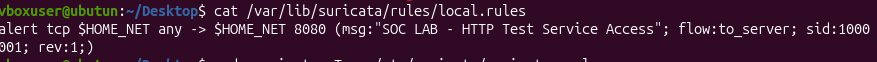
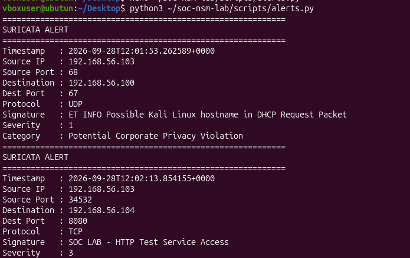
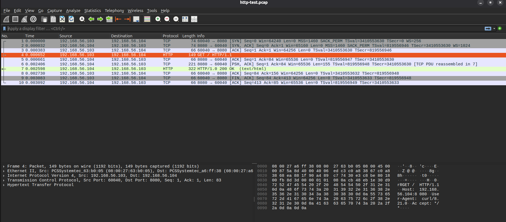
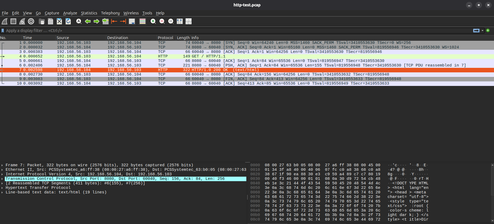

# Detection Analysis: Controlled HTTP Service Access

## Objective

Validate a custom Suricata rule by generating a known HTTP request from Kali to an Ubuntu test service.

## Service

Ubuntu:

```bash
python3 -m http.server 8080 --bind 192.168.56.104
```

Kali:

```bash
curl http://192.168.56.104:8080/
```

## Custom Rule

```suricata
alert tcp $HOME_NET any -> $HOME_NET 8080 (msg:"SOC LAB - HTTP Test Service Access"; flow:to_server; sid:1000001; rev:1;)
```



## Suricata Alert

The Python alert parser displayed:

```text
Source IP   : 192.168.56.103
Destination : 192.168.56.104
Dest Port   : 8080
Protocol    : TCP
Signature   : SOC LAB - HTTP Test Service Access
Severity    : 3
```



## Packet-Level Validation

The PCAP contains a TCP handshake followed by an HTTP request.



The response includes an HTTP `200 OK` response from the Ubuntu service.



## Conclusion

The custom rule was validated end-to-end: known traffic was generated, Suricata detected it, the alert was parsed, and the packet capture independently confirmed the HTTP request/response.
