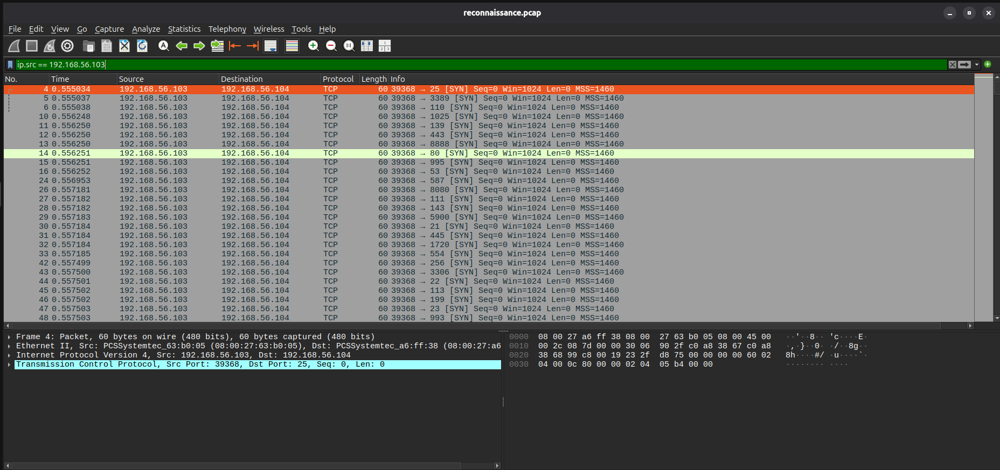

# Detection Analysis: Network Reconnaissance

## Objective

Identify and document controlled network reconnaissance generated from the Kali test VM toward the Ubuntu monitoring VM.

## Test Activity

Source:

```text
192.168.56.103 (Kali)
```

Destination:

```text
192.168.56.104 (Ubuntu)
```

Commands:

```bash
nmap -sS 192.168.56.104
nmap -sV 192.168.56.104
```

## Packet Evidence

The reconnaissance PCAP was opened in Wireshark. The capture shows repeated TCP SYN packets from the Kali source to many destination ports on the Ubuntu host, including examples such as 25, 3389, 110, 1025, 139, 443, 80, 995, 53, 587 and others.

This pattern is consistent with the controlled Nmap activity executed in the lab.



## Interpretation

The evidence establishes that the source VM performed TCP connection probing against the destination VM. The lab Nmap output reported the Ubuntu host as up and the tested ports as closed in the observed state.

No compromise is established by this activity. It is an authorized simulation inside an isolated lab.

## MITRE ATT&CK

**T1046 — Network Service Scanning**

The mapping describes the reconnaissance behavior represented by repeated network service probes.

## Analyst Actions

1. Confirm the source and destination addresses.
2. Review the packet pattern in Wireshark.
3. Compare the packet timing and ports with the known Nmap command.
4. Preserve the PCAP as investigation evidence.
5. Record the activity as authorized lab traffic.
6. Avoid treating the scan alone as proof of compromise.
