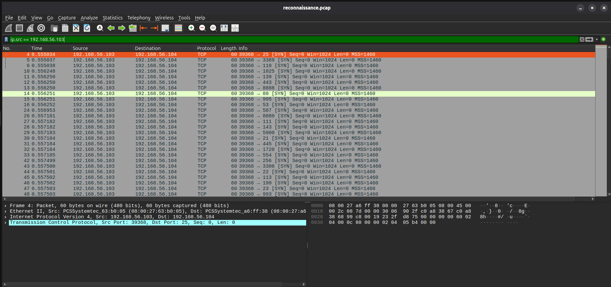

# INC-001 — Controlled Network Reconnaissance

| Field | Value |
|---|---|
| Incident ID | INC-001 |
| Classification | Authorized lab activity |
| Source | `192.168.56.103` (Kali) |
| Destination | `192.168.56.104` (Ubuntu) |
| Activity | TCP reconnaissance / service probing |
| Tool | Nmap |
| Evidence | Nmap output + `reconnaissance.pcap` + Wireshark |
| ATT&CK | T1046 — Network Service Scanning |
| Compromise established | No |

## Summary

Controlled TCP reconnaissance was generated from the Kali VM against the Ubuntu VM in the isolated host-only network. The packet capture shows repeated TCP SYN probes to multiple destination ports.

## Timeline

1. Kali and Ubuntu were connected through the `192.168.56.0/24` host-only network.
2. Nmap SYN and service-detection scans were executed against `192.168.56.104`.
3. Traffic was captured in `reconnaissance.pcap`.
4. The capture was opened in Wireshark.
5. Repeated TCP SYN probes from `192.168.56.103` to multiple ports on `192.168.56.104` were observed.
6. The activity was classified as authorized lab reconnaissance.

## Evidence

The visible packet pattern includes repeated SYN probes to different destination ports.

## Analysis

The activity is consistent with network service discovery. The scan was intentionally performed against the project VM, not against an external system.

The packet evidence supports the reconnaissance finding. The scan itself does not demonstrate successful access or compromise.

## Response

- Confirmed the source and destination were both lab VMs.
- Reviewed the packet capture.
- Documented the behavior and ATT&CK technique.
- Preserved the PCAP as local evidence.
- No containment action was required because the activity was authorized.

## Detection Improvement

A production SOC could correlate repeated connection attempts across many ports with asset identity, authentication context, firewall telemetry, and endpoint telemetry. Thresholds should be tuned to reduce false positives from legitimate administrative scanning.
