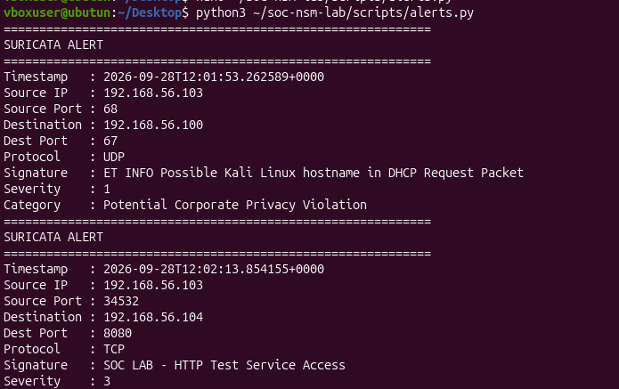
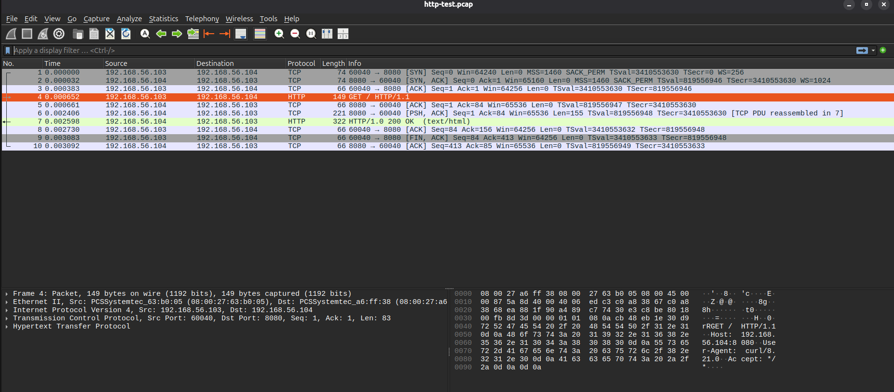
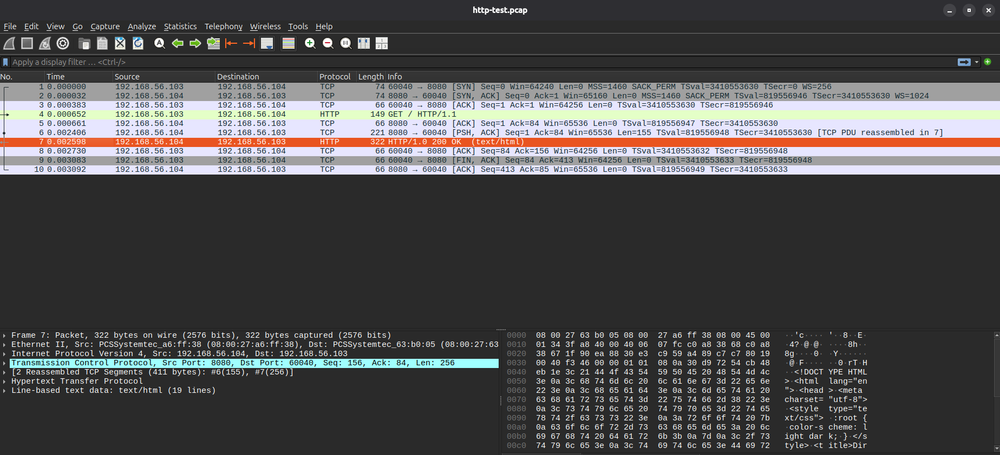

# INC-002 — Controlled HTTP Service Access

| Field | Value |
|---|---|
| Incident ID | INC-002 |
| Classification | Authorized lab activity |
| Source | `192.168.56.103` |
| Destination | `192.168.56.104:8080` |
| Protocol | TCP/HTTP |
| Detection | `SOC LAB - HTTP Test Service Access` |
| Severity | 3 in the observed Suricata alert |
| Evidence | EVE JSON + custom rule + `http-test.pcap` + Wireshark + server log |
| Compromise established | No |

## Summary

Kali accessed a Python SimpleHTTPServer running on Ubuntu TCP/8080. A custom Suricata signature detected the request. Wireshark independently confirmed the HTTP request and the successful HTTP response.

## Timeline

1. Ubuntu started a Python HTTP server on `192.168.56.104:8080`.
2. Kali requested `/` using curl.
3. Suricata generated `SOC LAB - HTTP Test Service Access`.
4. The alert parser extracted the source, destination, port, protocol and signature.
5. Wireshark showed the TCP handshake and HTTP GET.
6. Wireshark showed `HTTP/1.0 200 OK` in the server response.
7. The connection closed normally.

## Alert Evidence



## Packet Evidence

Request:



Response:



## PCAP Integrity

The dedicated HTTP capture contained 10 packets. The recorded SHA-256 for the capture was:

```text
a35cc9bf5726f5d7a8935001ae5a0406cc0b936b738b8a69aa1c6652f7cf
```

## Analysis

The custom detection worked as designed. The alert alone identifies the network behavior, while the PCAP confirms what actually traversed the monitored interface.

The HTTP request included:

```text
GET / HTTP/1.1
Host: 192.168.56.104:8080
User-Agent: curl/8.21.0
Accept: */*
```

The response was:

```text
HTTP/1.0 200 OK
```

No evidence in this test establishes compromise. The traffic was intentionally generated by the project operator.

## Detection Engineering Outcome

This incident demonstrates a complete custom detection workflow:

**Rule → Trigger → Alert → Parse → PCAP Correlation → Documentation**
